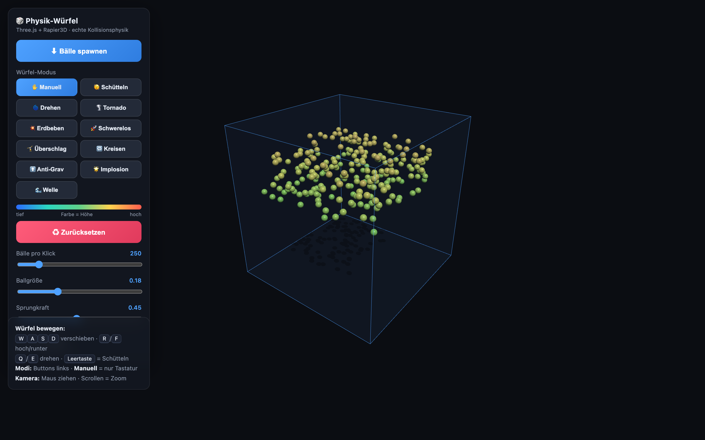
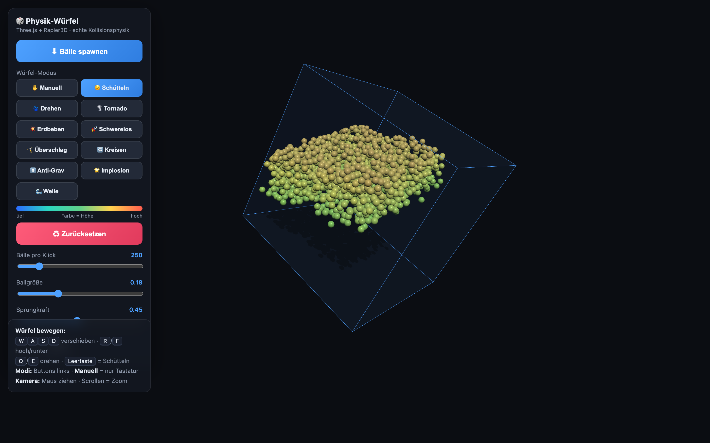

# Cube Physics Simulation

> Real 3D collision physics in the browser — thousands of balls inside a controllable cube.

An interactive 3D physics sandbox that runs entirely in the browser. Hundreds to thousands of balls fall into a steerable glass cube and collide using a real rigid-body physics engine ([Rapier3D](https://rapier.rs/), compiled to WebAssembly), rendered with [Three.js](https://threejs.org/). You can move and rotate the cube with the keyboard and drive it through 11 animation modes — shake, tornado, earthquake, zero-g, implosion, wave, and more. The entire app is a single HTML file with no build step.

## Features

- **Real rigid-body physics** powered by the Rapier3D engine (WASM) with true ball-to-ball collision response.
- **High-performance rendering** via Three.js `InstancedMesh`, drawing thousands of balls (hard cap of 6000) in a single draw call.
- **Kinematic glass cube** built from six walls that physically push the balls when the cube moves or rotates.
- **11 cube modes:** Manual, Shake, Spin, Tornado, Quake, Zero-G, Flip, Orbit, Anti-Grav, Implode, and Wave.
- **Per-ball forces** applied every frame — swirl, inward pull, traveling wave, and extra gravity — to create each mode's effect.
- **Keyboard control** of the cube (`WASD` to move, `R`/`F` for up/down, `Q`/`E` to rotate, `Space` to shake) plus an OrbitControls camera (drag to orbit, scroll to zoom).
- **Height-based coloring** of the balls via HSL (blue at the bottom to red at the top).
- **Safety net** that detects balls escaping the rotated cube and pulls them back inside while damping their velocity.
- **Live controls** for balls per click, ball size, and bounciness (restitution).
- **Real-time stats:** ball count, FPS, and per-frame physics step time in milliseconds.
- **Continuous Collision Detection (CCD)** to prevent fast balls from tunneling through walls, plus soft shadows (`PCFSoftShadowMap`) and a glass/transmission material.
- **Fully serverless:** one HTML file, dependencies loaded at runtime via an ES module import map from esm.sh.

## Tech Stack

- **HTML5 / CSS3** — single-file layout and UI styling
- **JavaScript (ES Modules)** — application logic, loaded directly in the browser
- **[Three.js](https://threejs.org/) 0.160.0** — WebGL rendering
- **[Rapier3D](https://rapier.rs/) (`@dimforge/rapier3d-compat` 0.14.0)** — WASM rigid-body physics engine
- **WebGL** — hardware-accelerated graphics
- **esm.sh CDN + Import Maps** — runtime module resolution, no bundler required

## Getting Started

No installation, build step, or package manager is required.

1. Clone the repository:
   ```bash
   git clone https://github.com/AralimNGA/cube-physics-simulation.git
   cd cube-physics-simulation
   ```
2. Open `physik_wuerfel.html` in a modern browser (Chrome, Firefox, Safari, or Edge).
3. An internet connection is required on first load: Three.js and Rapier3D are fetched at runtime via the import map from esm.sh.

Some browsers restrict ES module imports when a page is opened directly from the file system. If the app does not load, serve the folder over a simple local web server instead:

```bash
python3 -m http.server 8000
```

Then open <http://localhost:8000/physik_wuerfel.html>.

### Controls

- **Move cube:** `W` `A` `S` `D` to slide, `R` / `F` for up / down
- **Rotate cube:** `Q` / `E`
- **Shake:** `Space`
- **Camera:** drag to orbit, scroll to zoom
- **Modes:** use the buttons in the on-screen panel (Manual = keyboard only)

> Note: The in-app UI is in German.

## Screenshots

<table>
  <tr>
    <td align="center"><br><sub>Default view — thousands of balls settling in the cube</sub></td>
    <td align="center"><br><sub>Shake mode — the whole cube tilts and tumbles the balls</sub></td>
  </tr>
</table>

## Project Status

Complete. This is a self-contained portfolio project and a finished, working prototype. There is no backend, build pipeline, or test suite — it is intended to be opened and explored directly.

## How it was made

Built with the help of an AI coding agent (Claude Code).

## License

MIT, see [LICENSE](LICENSE). Three.js (MIT) and Rapier3D (Apache-2.0) are loaded from esm.sh at runtime and are not part of this repository.
